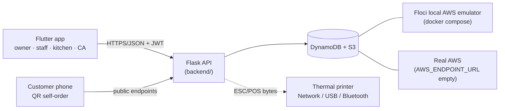

# Cafe POS


Offline-first point-of-sale for cafes: GST billing, KOT + thermal printing, QR
table self-ordering, recipe-based inventory, and Tally/GST export — built for
the Indian cafe trade (Gujarat first).

## Features

- **GST billing** — per-line CGST/SGST with HSN codes, tax-inclusive pricing,
  server-side total recomputation (client totals are never trusted).
- **Split payments** — cash / UPI / card / Google Pay / credit / loyalty in one
  bill, with exact-sum validation. Google Pay runs in **test mode** by default.
- **KOT + thermal printing** — auto or manual KOTs; any ESC/POS printer
  (Epson, Xprinter, TVS, Bixolon, generic 58/80 mm) over **Network, USB-OTG or
  Bluetooth**, configured in-app by the owner.
- **QR table self-ordering** — a QR code per table (`/public/qr/<n>`), public
  menu, customer cart/checkout and order tracking; QR orders join the same
  staff queue without stealing a table lock.
- **Loyalty** — phone-based points ledger: earn on payment, redeem as a payment
  line at collect time.
- **Inventory** — recipe-based auto-deduction per sale, `reorder_level`
  low-stock alerts, vendor stock-order message on WhatsApp.
- **Floor map** — drag-to-design table layout (zone, position, size, shape)
  with a staff Grid/Floor toggle.
- **Delivery ingestion** — Swiggy/Zomato order adapter (API-key auth) feeding
  the same order queue and a Delivery view.
- **Owner dashboard** — sales analytics, P&L, best sellers, staff sales, and a
  day-end **Z-report** (tax breakup, payment modes, expected cash).
- **Accounting bridge** — Tally Prime Import-Data **XML + CSV**, **GSTR-1 /
  GSTR-3B** export, and a read-only **CA login** (`cafe_ca` role).
- **Offline-first** — durable mutation queue on the device, connectivity-triggered
  sync (`/sync/batch`, `/sync/pull`), offline order placement with temp-id
  reconciliation.
- **Built for the Gujarati market** — INR-first, cafe workflows first, priced
  and positioned against Tally-centric counter software (Gujarati/Hindi i18n is
  on the roadmap).

## Architecture

One Flutter app serves four staff roles plus customers ordering from a table
QR. It talks only to the Flask API; the API is the only thing that touches
storage — DynamoDB + S3 on **Floci** (a local AWS emulator) in development, or
real AWS in production by unsetting `AWS_ENDPOINT_URL`. Auth is JWT with exact
role guards (`owner`, `staff`, `kitchen`, `cafe_ca`). Printing is ESC/POS bytes
built server-side and sent by the app (direct socket/USB/Bluetooth) or relayed
by the backend on web.



Money is stored as integers in minor units (paise) end-to-end.

## Multi-cafe / multi-hostel (tenants)

One deployment serves any number of businesses. Each **tenant** gets its own
isolated DynamoDB table set **named after it** (`bean_orders`,
`city_hostel_menu_items`, …) plus its own registry row in the global
`cafe_tenants` table (display name, GSTIN, address, phone, bill footer,
kitchen-printer host, QR base URL). The default tenant (`main`) keeps the
legacy unprefixed table names.

- **Onboard a new cafe/hostel:**
  ```bash
  docker compose exec backend python scripts/create_tenant.py \
      --slug bean --name "Bean House Cafe" --kind cafe \
      --owner-user beanowner --owner-password secret123 \
      --gstin 24BHOUSE0001A1Z5 --address "12 MG Road, Ahmedabad" \
      --phone "+91 98765 43210" --bill-footer "Thank you! WiFi: bean-guest" \
      --kitchen-printer-host 192.168.1.50
  ```
- **Login:** staff sign in with an optional **cafe code** (tenant slug); the
  JWT carries the tenant and every request is scoped to that cafe's tables.
- **Branding:** the app shows the cafe's own name (shell headers, customer
  menu hero); receipts and KOTs print that cafe's name/GSTIN/footer.
- **Customer QR:** table QRs encode `{base}/t/<slug>/table/<n>` and open that
  cafe's self-order menu directly (web deep link).
- **Cloud migration:** moving one cafe to real AWS = point its table set at a
  real DynamoDB account (unset `AWS_ENDPOINT_URL` per tenant process) — no
  code changes; if you later prefer SQL, one tenant maps to one database.

## Kitchen KOT routing

Every order prints **exactly one** kitchen ticket when `AUTO_PRINT_KOT=1`:
staff counter orders, customer QR orders, and Swiggy/Zomato ingests all route
to the tenant's `kitchen_printer_host` (falling back to env
`ESCPOS_PRINTER_HOST`). The KOT shows the order source (`COUNTER` / `QR
TABLE 5` / `SWIGGY`), customer name + phone last-4, items with options, and
notes. Offline sync replays are deduped, so a queued order can never double-
print.

## Quick start

Backend (API + local AWS emulator):

```bash
docker compose up -d --build        # Floci + Flask API
docker compose logs -f backend      # first boot prints the seed logins
curl localhost:9999/health
```

The API serves `http://localhost:9999` (override with `BACKEND_PORT` in `.env`).
Seeded logins: **owner / cafe123**, **priya / staff123** (approved staff),
**sam / staff123** (pending, to demo the approval flow). Kitchen and CA accounts
are created by the owner.

App:

```bash
cd mobile
flutter pub get
flutter run                            # Android emulator -> http://10.0.2.2:9999
flutter run -d chrome                  # web build
flutter run --dart-define=API_BASE_URL=http://<your-lan-ip>:9999   # physical device
```

On web/desktop/iOS-simulator builds the app defaults to the hosted demo API, so
pass `API_BASE_URL` to point it at your local backend. To demo beyond your LAN:
`docker compose --profile tunnel up -d tunnel` (random trycloudflare URL in the
logs), or a stable named tunnel via `TUNNEL_TOKEN` in `.env` (profile
`tunnel-token`). See `backend/README.md` for the non-Docker setup (Floci CLI +
venv) and the full endpoint list.

## Project layout

| Path | What it is |
|------|------------|
| `backend/` | Flask API — JWT auth + roles, menu/orders/tables, billing, printing, sync, exports; `tests/` (offline suites) and `scripts/` (bootstrap/seed) |
| `mobile/` | Flutter app — owner / staff / kitchen / CA shells + customer QR self-order flow (Android, iOS, web, desktop) |
| `docker-compose.yml` | Demo stack: Floci (DynamoDB/S3 emulator) + backend + optional Cloudflare tunnel |
| `IMPLEMENTATION_STATUS.md` | What is built, phase by phase |
| `DEMO_GUIDE.md` | End-to-end demo script (staff order → owner billing) |
| `cafe-pos-startup-plan.md` | Market strategy and roadmap |

## Testing

Backend (from `backend/`, deps in `requirements.txt` — all suites run offline
against an in-memory AWS stub, no Floci or network needed):

```bash
python tests/smoke_offline.py               # full POS flow (login → order → collect → reports)
python tests/test_phase1_billing.py         # GST, split payments, Z-report
python tests/test_phase2_ops.py             # KOT, floor map, inventory alerts
python tests/test_phase3_growth.py          # QR ordering, loyalty, delivery adapter
python tests/test_phase4_tally.py           # Tally XML/CSV, GSTR-1/3B, CA role guards
python tests/test_sync.py                   # offline batch/pull sync
python tests/test_printing_config.py        # printer config + role guards
python tests/test_ask_offline.py            # offline assistant
python tests/test_recommendations_offline.py
```

`tests/smoke_test.py` is the same flow against moto (`pip install moto`);
`tests/e2e_demo.py` drives a live Floci-backed server.

Mobile:

```bash
flutter analyze
flutter test
```

The test suite covers widgets, layout, and the offline queue, plus golden
screenshots — after UI changes re-run `flutter test --update-goldens` to refresh
them.

## Notable gaps (honest roadmap)

Payments are bookkeeping + Google Pay test mode (no production gateway yet);
WhatsApp billing uses a `wa.me` deep link, not the Business API; the
Swiggy/Zomato adapter needs real partner credentials; nightly Tally auto-sync
needs a scheduler; native QR deep-link handling, Gujarati/Hindi i18n, and an
offline-hardened web PWA are still open.

## Documentation

- [IMPLEMENTATION_STATUS.md](IMPLEMENTATION_STATUS.md) — built features, phase by phase
- [DEMO_GUIDE.md](DEMO_GUIDE.md) — run the full demo
- [cafe-pos-startup-plan.md](cafe-pos-startup-plan.md) — market strategy
- [PLAN.md](PLAN.md) — original build plan (stack history)
- [backend/README.md](backend/README.md) — API setup, roles, endpoints
- [mobile/README.md](mobile/README.md) — app setup, roles, printing, offline
